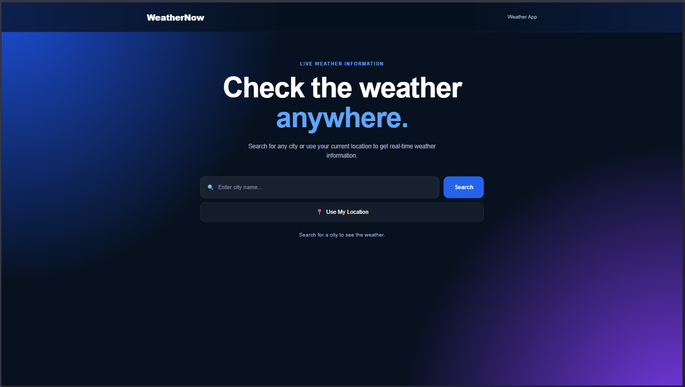
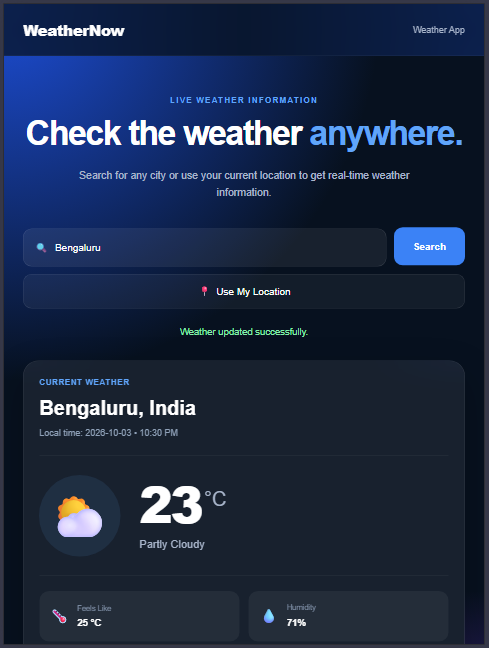
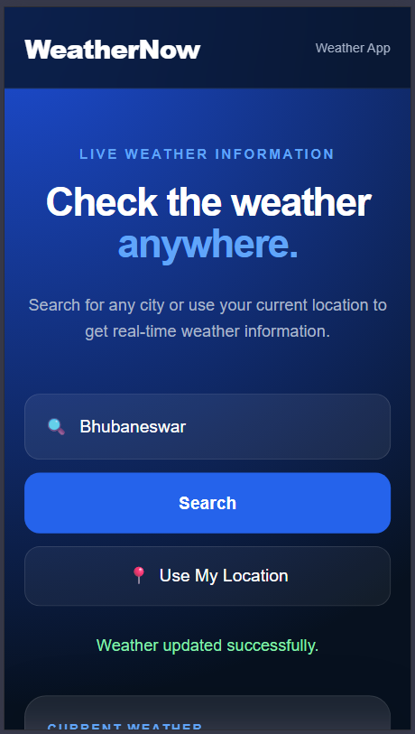

# 🌦️ PRODIGY_WD_05 — Weather App

A responsive weather application developed as part of my **Prodigy InfoTech Web Development Internship**.

The application allows users to search for weather information by entering a location or by using their current browser location.

---

## 🚀 Live Demo

[View Live Demo](https://jaydeepprasad2020-max.github.io/PRODIGY_WD_05/)

---

## ✨ Features

- 🔎 Search weather by city name
- 📍 Get weather using current location
- 🌡️ Current temperature
- 🌤️ Weather condition and weather icon
- 🌡️ Feels-like temperature
- 💧 Humidity
- 💨 Wind speed
- 🌧️ Precipitation
- 🔽 Atmospheric pressure
- 🌅 Sunrise time
- 🌇 Sunset time
- 🕐 Local timezone
- ⚡ Loading and error messages
- 💾 Remembers the last searched city
- 📱 Fully responsive design
- 💻 Desktop, tablet and mobile support

---

## 🛠️ Technologies Used

- HTML5
- CSS3
- JavaScript
- Fetch API
- Browser Geolocation API
- Open-Meteo Weather API
- Open-Meteo Geocoding API
- LocalStorage

---

## 📸 Screenshots

### 💻 Responsive Design Preview

<table>
  <tr>
    <th>Desktop</th>
    <th>Tablet</th>
    <th>Mobile</th>
  </tr>
  <tr>
    <td>
      
    </td>
    <td>
      
    </td>
    <td>
      
    </td>
  </tr>
</table>

---

## 🌐 API

Weather data is provided by **Open-Meteo**.

The application uses:

- Open-Meteo Geocoding API for converting a searched city into coordinates.
- Open-Meteo Weather Forecast API for retrieving weather information using latitude and longitude.

---

## 📂 Project Structure

```text
PRODIGY_WD_05/
│
├── index.html
├── style.css
├── script.js
└── README.md